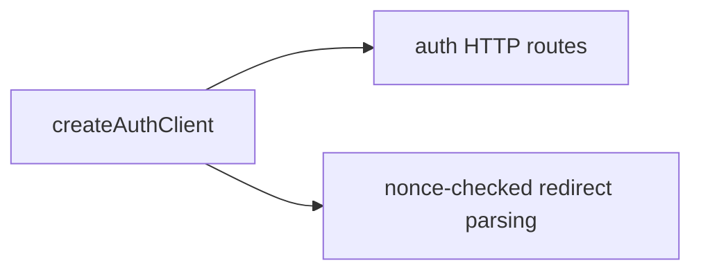

# @yingyeothon/auth-client

The game's wire client for an auth channel: config, OAuth start URL, redirect
nonce checks, provider-token exchange and server verification. Browser navigation
belongs to the caller; `game-kit` supplies a popup adapter.



## Install

```bash
npm install @yingyeothon/auth-client
```

## Usage

```ts
import { createAuthClient, createAuthNonce } from "@yingyeothon/auth-client";
const auth = createAuthClient({ baseUrl: "https://auth.yyt.life", channelId });
const nonce = createAuthNonce();
const startUrl = auth.buildStartUrl({ provider: "github", redirectUrl, nonce });
// Open startUrl with the host's browser. On return:
const token = auth.parseRedirect({
  returnedUrl,
  redirectUrl,
  expectedNonce: nonce,
});
```

CJS uses `require("@yingyeothon/auth-client")`. Discard the returned URL and
remove its credential fragment after parsing. Redirect parsing checks the
protocol, host, path and nonce, then checks token metadata against the fragment.
It does not verify the JWT signature. Use `verify` when server verification is
needed; a 401 returns `undefined`. No token is persisted or logged.

## Public API

- `createAuthClient(AuthClientOptions)` returns `AuthClient`: `fetchConfig`,
  `buildStartUrl(AuthStartOptions)`, `parseRedirect(AuthRedirectOptions)`,
  `exchange(AuthExchangeOptions)`, `verify(jwt)`.
- `AuthClientOptions`: `baseUrl`, `channelId`, structural `fetch?`, `logger?`.
- `AuthChannelConfig`: issuer, audience, providers, start URL, redirect allowlist,
  TTL and optional channel expiry. `ChannelToken`: `jwt`, `userId`, epoch-second `exp`.
- `createAuthNonce`: 32 secure random bytes as unpadded base64url.
- `readTokenClaims`: reads identity metadata without signature verification.
- `AuthClientError`, `isAuthClientError`: safe code/status diagnostics with no
  body, URL or raw exception cause.
- `AuthFetchLike`, `AuthFetchRequest`, `AuthFetchResponse`: injectable HTTP seam.

## Behavior changes

New package. Exactly one provider credential is required by `exchange`.
The wire contract belongs to the service repository; opening a browser and
secure storage belong to the host application.
