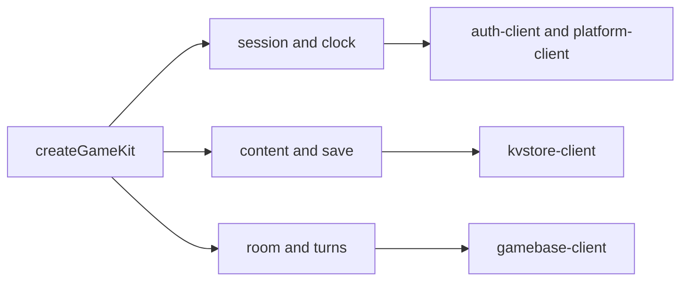

# @yingyeothon/game-kit

Purpose-shaped game modules for the yyt platform. Wave A provides a shared
session and clock, content, conditional saves, host rooms and deterministic
turn logs. The service's `docs/game-kit-design.md` owns the cross-language
contract. This package uses wire packages' public APIs and exposes game nouns.



## Install

```bash
npm install @yingyeothon/game-kit
```

## Usage

```ts
import { createGameKit } from "@yingyeothon/game-kit";
const kit = createGameKit({ config: kitConfig });
await kit.session.fromToken(channelJwt);
const progress = await kit.save.load<{ level: number }>("progress");
await kit.save.store("progress", { ...progress, level: 2 });
await kit.room.create();
```

CJS uses `require("@yingyeothon/game-kit")`. A missing module configuration
fails on first use. A save reads its base before its first write; it never
silently overwrites a newer version. [Game kit](../../docs/game-kit.md) contains
the walkthrough and [the runnable example](../../examples/game-kit/README.md)
needs no credentials or infrastructure.

## Session and lifecycle

`fromToken` adopts JWT identity metadata, not a verified signature. The platform
verifies access on each request. The `/time` request establishes a monotonic
midpoint anchor; `session.now()` returns epoch milliseconds and never uses the
device wall clock. `expiresAt` is epoch seconds. Before a successful time sync,
`now()` reports `unavailable`; an offline session can still enqueue known-base
save writes. Clock synchronization retries on foreground resume.

`expiring` fires once per adopted token at expiry minus ten minutes. Expiry or
any module's 401 emits `signedOut` once and stops timers and sockets. Token
storage is opt-in (`TokenStorage`); the browser default stores nothing. Store
and clear operations are serialized, and late responses cannot replace a newer
session. `restore` loads the opted-in token; `signOut` clears it. `dispose`
closes execution resources without deleting durable storage.

`signIn` requires `login.redirectUrl` on the auth channel's allowlist. The
browser default opens a popup synchronously and polls it every 200 ms until
its callback is readable, then removes its fragment and closes it. The default
`login.timeoutMs` is 600000. A `LoginAdapter` opens a system browser and returns
a `LoginFlow` (`returnedUrl`, `cancel`) in mobile or Node hosts. Popup blocking,
OAuth errors, cancelled windows and timeout are failures, never successful login.

Call `setForeground(false)` on background entry and `true` on return. Browsers
should forward `visibilitychange`; mobile hosts forward their engine lifecycle.
The kit does not install engine hooks or persist tokens automatically.

## Content and save

Content uses the `collections.content` alias. `subscribe` defaults to a 60000 ms
`content.pollIntervalMs` (minimum 1000), shares reads per key and pauses polling
in the background. Entry ETag versions determine changes. The state API has no
304 reads, so polling still downloads the value. A cached `get` returns
immediately and refreshes; a cold read awaits the service. `list` follows pages.

Save uses `collections.save` in the player's own namespace. `load` keeps the
version. `store` and `update` use conditional writes; a conflict reloads and
calls the supplied merge policy with `(local, remote)`. `save.maxMergeRetries`
defaults to 3. Counter bounds are server-side guards. `claimOnce(name, ttl)` is
create-only and false on a lost create condition; TTL is in seconds.

An optional `save.offlineQueue` must implement durable `load(namespace)` and
`store(namespace, records)`. It queues store/remove only, using an already-known
base version and a JSON value, and acknowledges only after durable storage.
Queues are isolated by endpoint, auth channel, collection and user. Restoration
is lazy on save use; `pendingCount` reflects the loaded queue. `flush` replays
in order. Call it on connectivity recovery; foreground resume also flushes.
A policy in `save.mergePolicies[name]` handles restored conflicts. An inline
merge lives only in the current process. Without a policy, conflict retains the
record and stops replay. Sign-out stops execution but keeps the isolated queue.
A retry acknowledges an already-satisfied newer revision containing the same
value; it never overwrites a differing value to recover a lost acknowledgement.
Counters and claims require a live answer and are never queued or auto-retried.

## Rooms and turns

Room connections are lazy. Registering a room observer starts listening after
sign-in. Party commands are serialized; `room.timeoutMs` defaults to 10000.
Create, invite, accept and leave wait for their roster outcome. Decline has no
invitee acknowledgement on the wire and resolves after sending. Event sends
likewise report submission, not confirmed delivery.

The party leader is authoritative by agreement. `state.publish` accepts JSON
snapshots from the host; members retain the latest state. Host succession calls
`becomeHost({ lastKnown })`. Reconnection automatically requests that snapshot.
Kit control names begin with `kit.` and cannot be used by game senders. Events
carry sender session/sequence metadata and discard duplicates. The entire
UTF-8 JSON envelope, including metadata, must fit 8192 bytes. Large game state
must use application-defined deltas.

Turns require the kit's room, a player order and deterministic pure `apply`.
`submit` checks the turn and hash chain. Hash/apply divergence emits `mismatch`
and freezes; the game decides how to recover. Hashes use RFC 8785 JCS and SHA-256,
not object insertion order. Values must be finite JSON, with valid Unicode,
plain objects and dense arrays; custom serializers/getters are refused.
Each encoded turn record is at most 7000 bytes to leave room for log envelopes.
`elapsed` is informational per-player monotonic milliseconds, local to this
instance and not restored from a log.

Resync receives a manifest and paced chunks (5/s) from one selected peer, with
a 30-second assembly timeout. `maxLogBytes` defaults to 1048576. Complete hash
verification precedes state replacement; live turns during resync are buffered.
The host normally answers, with another online member used when the host is
recovering or offline. With `persist: true`, immutable revision chunks precede
a conditional manifest commit in save. Each row fits 16384 bytes;
`logTtlSeconds` defaults to 604800 (7 days). Partial revisions are not restored.
Old revisions expire instead of being eagerly deleted. Persistence failures are
reported separately from mismatch; they do not freeze a valid game.

Only the host calls `finish`. Every player records its own copy in
`saveResultAs`, when configured. A failed sink can be retried with the same
`finish` result or on foreground resume. Wave A has no board sink.

## Public API

- `createGameKit(GameKitOptions)` returns `GameKit`: `session`, `content`, `save`,
  `room`, `turns.start`, `setForeground`, `dispose`.
- `GameKitConfig`: public auth/state/gateway settings and collection aliases.
  `GameKitOptions`: config, fetch/WebSocket/logger/scheduler injection, login,
  tokenStorage, content/save/room options. `KitScheduler`: monotonic `now` and
  cancellable `schedule`.
- `Session`, `SessionIdentity`: signIn/fromToken/restore/signOut/now, identity,
  expiring/signedOut events. `TokenStorage`, `LoginAdapter`, `LoginFlow` are
  opt-in host seams.
- `Content`, `ContentEntry`: get/list/subscribe over published content.
- `Save`, `SaveStoreOptions`, `MergePolicy`: load/store/update/remove,
  counter.add, claimOnce, flush and pendingCount. `OfflineQueueStorage` and
  `QueuedWrite` describe the optional durable queue.
- `Room`, `RoomMember`, `RoomInvitation`, `RoomEvents`: membership, invitations,
  host/state events, send/whisper, state.publish and becomeHost.
- `TurnsStartOptions`, `TurnGame`, `TurnRecord`: player order, initial/apply,
  persistence/result options; state/index/log/elapsed/frozen, submit/finish/on/dispose.
- `KitError`, `KitErrorCode`, `isKitError`: purpose-level errors with module,
  code, retryable and a sanitized diagnostic cause. Local invalid arguments
  throw TypeError or RangeError.

## Behavior changes

New package. Board, mail, friends, matchmaking and push are subsequent waves.
Fake scenarios prove library behavior, not deployed gateway or device delivery.
