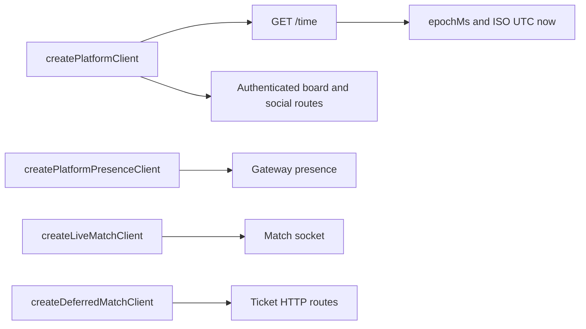

# @yingyeothon/platform-client

Platform wire clients for time, leaderboards, social profiles/relations, gateway
presence and live/deferred matchmaking. They validate required fields and preserve
future match fields without applying kit polling or room policy.



## Install

```bash
npm install @yingyeothon/platform-client
```

## Usage

```ts
import { createPlatformClient } from "@yingyeothon/platform-client";
const platform = createPlatformClient({ baseUrl: "https://doc.yyt.life" });
const time = await platform.time();
```

CJS uses `require("@yingyeothon/platform-client")`. Only time requests send no bearer;
`game-kit` anchors the returned time to an injected monotonic clock.

## Authenticated surfaces

`createPlatformClient({baseUrl, token?, fetch?, logger?})` keeps time anonymous.
`board(nameOrId)` exposes info/submit/top/me; social exposes profile/setProfile,
profiles/friends/requests/request/accept/decline/remove/block/unblock. Board submit
returns the service's `{submitted, periods}` with stored scores and no rank.
`me` and profile return undefined for a missing row. Authenticated methods require
a token when called and reject HTTP redirects.

`createPlatformPresenceClient({baseUrl, channelId, token, fetch?, logger?})`
provides users(ids), at most 50 player IDs. Supply the gateway HTTP origin.
`createDeferredMatchClient` uses the match API base/channel/token and exposes
submit/status/cancel/accept/decline. It does not retry or poll automatically.
`createLiveMatchClient({url, channelId, token, WebSocket?, logger?})` connects
with bearer subprotocols, resolves find with the matched frame and closes on
terminal outcome or cancel. Supply WebSocket on Node 20.

Errors include safe status/code/reason/retryAfterMs. Deferred retryAfter seconds
are exposed as milliseconds. No raw response message, URL, token or cause is
retained. Structural fetch defaults to global fetch; logging defaults null.

## Public API

- `createPlatformClient(PlatformClientOptions)` returns `PlatformClient` with
  `time(): Promise<PlatformTime>`.
- `PlatformClientOptions`: `baseUrl`, structural `fetch?`, `logger?`.
- `PlatformTime`: ISO UTC `now`, integer `epochMs` in milliseconds.
- `PlatformClientError`, `isPlatformClientError`: safe status/code errors.
- `PlatformFetchLike`, `PlatformFetchRequest`, `PlatformFetchResponse`: structural
  HTTP types, compatible with the global fetch without DOM declarations.

### Additional named exports

- `createPlatformClient`
- `createPlatformPresenceClient`
- `createLiveMatchClient`
- `createDeferredMatchClient`
- `BoardPeriod`
- `PlatformBoardPeriod`
- `PlatformBoardInfo`
- `PlatformBoardScore`
- `PlatformBoardPage`
- `PlatformBoardOwnScore`
- `PlatformBoardSubmitOptions`
- `PlatformBoardTopOptions`
- `PlatformBoardSubmission`
- `PlatformBoardSubmitResult`
- `PlatformBoard`
- `PlatformProfile`
- `PlatformProfileOptions`
- `PlatformRelation`
- `PlatformRequests`
- `PlatformSocial`
- `PlatformPresenceClientOptions`
- `PlatformPresence`
- `PlatformPresenceClient`
- `MatchMember`
- `MatchResult`
- `MatchTicket`
- `DeferredMatchClientOptions`
- `DeferredMatchClient`
- `LiveMatchClientOptions`
- `LiveMatchClient`

## Behavior changes

New package. Malformed responses and HTTP/network refusals carry safe errors;
neither response bodies nor URLs enter those errors.
