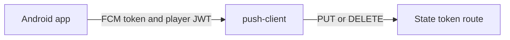

# @yingyeothon/push-client

Registers caller-supplied Android FCM tokens using a player JWT. No FCM SDK is included. iOS and browser Web Push are unsupported.

The wrapper sends to the platform's HTTP routes.



## Install

```bash
pnpm add @yingyeothon/push-client
```

## Usage

Supply the credentials and identifiers from your own configuration.

```typescript
import { createPushClient } from "@yingyeothon/push-client";

const push = createPushClient({
  baseUrl: "https://state.example",
  channelId: "push_1",
  token: playerJwt,
});
await push.register({ token: fcmToken, project: "my-firebase-project" });
// Re-register on every app start and FCM token refresh.
await push.unregister({ token: fcmToken }); // Sign out before clearing the JWT.
```

The CommonJS entry exposes the same named API:

```javascript
const { createPushClient } = require("@yingyeothon/push-client");
```

## Security

**Server API keys never belong in an app.** Device tokens belong only in token
registration requests. Neither errors nor logs retain request bodies, credentials,
raw response messages or underlying exceptions. Base URLs must be HTTP(S) without
userinfo, query or fragment. Redirects are refused to protect credentials.

The injected `fetch` is structural; global fetch is the default. `logger` defaults
to `nullLogger`. `timeoutMs` defaults to 30000 per request, including body reads.
No request retries automatically. Error `status` is 0 for network or encoding
failure; known service `code`, `reason` and `retryAfterMs` are safe descriptors.
Unknown service codes fall back to `http_<status>` and unknown reasons are omitted.

## Registration lifecycle

The constructor's `token` is a player JWT; the method's `token` is an FCM
registration token. Refresh registration on start and token refresh, and remove
it on sign-out. Always send the Firebase `project` when available: a channel
accepting two projects requires it. SDK setup and topic subscription belong to
the app; topic messages are public.

See the [push guide](../../docs/push.md) for the canonical service contract and
an executable example.

## Public API

- `PushClientOptions`
- `PushRegisterOptions`
- `PushUnregisterOptions`
- `PushClient`
- `createPushClient`
- `isPushClientError`
- `PushClientError`
- `PushClientFetchLike`
- `PushClientFetchRequest`
- `PushClientFetchResponse`

## Migrating from the legacy package

This is a new package with no legacy import path.
