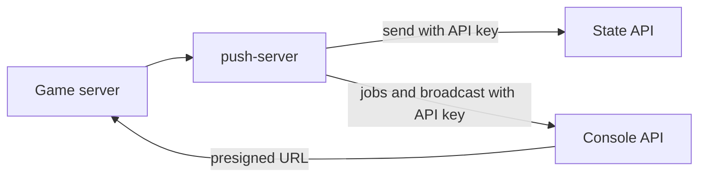

# @yingyeothon/push-server

Sends targeted Android push messages and manages campaigns with a server API key. No FCM SDK is included. iOS and browser Web Push are unsupported.

The wrapper sends to the platform's HTTP routes.



## Install

```bash
pnpm add @yingyeothon/push-server
```

## Usage

Supply the credentials and identifiers from your own configuration.

```typescript
import { createPushServer } from "@yingyeothon/push-server";

const push = createPushServer({
  stateBaseUrl: "https://state.example",
  consoleBaseUrl: "https://console.example",
  channelId: "push_1",
  apiKey: serverApiKey,
});
const result = await push.send({ userIds: [userId], data: { kind: "invite" } });
// Only resend failed recipients whose reason is budget or unavailable.
```

The CommonJS entry exposes the same named API:

```javascript
const { createPushServer } = require("@yingyeothon/push-server");
```

## Security

**Server API keys never belong in an app.** Device tokens belong only in token
registration requests. Neither errors nor logs retain request bodies, credentials,
raw response messages or underlying exceptions. Base URLs must be HTTP(S) without
userinfo, query or fragment. Redirects are refused to protect credentials.

The injected `fetch` is structural; global fetch is the default. `logger` defaults
to `nullLogger`. `timeoutMs` defaults to 30000 per request, including body reads.
No request retries automatically. Error `status` is 0 for network or encoding
failure; known service `code`, `reason` and `retryAfterMs` are safe descriptors.
Unknown service codes fall back to `http_<status>` and unknown reasons are omitted.

## Campaigns and reports

`createUpload({size, sha256?})` returns the presigned PUT URL, method and signed
headers. Upload the exact CSV bytes yourself with those headers, **without the
API key**. `submitJob` requires caller-supplied `templateId`, `uploadId` and
`idempotencyKey`. Template management belongs to the console.

`listUploads` and `listJobs` accept pagination; job lookup alternatively accepts
`idempotencyKey`. `getJob` and `cancelJob` return a job directly. `getReportUrl`
returns a presigned GET URL and both expiry times; download it without the API key.
`broadcast` accepts a template or inline title/body/data plus an idempotency key.
Broadcast topics are public, so a topic message grants no entitlement.

`sent` means FCM accepted at least one device, not that a device received it.
Targeted send is not idempotent: ambiguous network errors must not trigger a
whole-call resend. Jobs and broadcasts retain the caller's idempotency key.

The [push guide](../../docs/push.md) links the canonical wire contract and a
zero-infrastructure example.

## Public API

- `createPushServer`
- `isPushServerError`
- `PushServerError`
- `PushServerFetchLike`
- `PushServerFetchRequest`
- `PushServerFetchResponse`
- `PushServerOptions`
- `PushDeliveryOptions`
- `PushSendOptions`
- `PushRecipientResult`
- `PushSendResult`
- `PushCreateUploadOptions`
- `PushUpload`
- `PushUploadEntry`
- `PushListUploadsOptions`
- `PushUploadsPage`
- `PushSubmitJobOptions`
- `PushJobCounts`
- `PushJob`
- `PushJobSubmission`
- `PushListJobsOptions`
- `PushJobsPage`
- `PushReportUrl`
- `PushBroadcastOptions`
- `PushServer`

## Migrating from the legacy package

This is a new package with no legacy import path.
