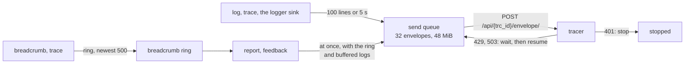

# @yingyeothon/tracer-client

Client for **tracer**, the yyt platform's debug-data collector: a web game or a Node server/Lambda remembers breadcrumbs, buffers log lines, and sends a report (an event with the breadcrumb trail, the logs, a screenshot and other files) plus a player's feedback, all readable afterwards with `yyt tracer`. It speaks the subset of the Sentry envelope that tracer ingests, needs no Sentry package, runs in browsers and on Node >= 20 with no dependency beyond `@yingyeothon/logger`, never throws into the caller, and is off when the DSN is empty. The normative wire contract is _Wire contract for client libraries_ in the service repository's `docs/tracer.md`; [the guide page](../../docs/tracer.md) explains how a game wires it in.

A client keeps a breadcrumb ring and a log buffer in memory and sends envelopes one at a time from a bounded queue.



## Install

```bash
npm install @yingyeothon/tracer-client
```

## Usage

ESM:

```ts
import {
  attachBrowserHooks,
  captureCanvasScreenshot,
  createTracerClient,
} from "@yingyeothon/tracer-client";

declare const canvas: HTMLCanvasElement; // the game's canvas
declare const roomId: string;

const tracer = createTracerClient({
  dsn: import.meta.env.VITE_TRACER_DSN ?? "", // from `yyt tracer dsn <res>` at build time; empty = off
  release: "my-game@1.4.0+52",
  dist: import.meta.env.VITE_GIT_SHA, // lets a reader check out the exact code
  environment: "debug",
  tags: { runtime: "browser" },
});
attachBrowserHooks(tracer); // uncaught errors as breadcrumbs, flush when the tab hides

tracer.trace("room", "joined", { data: { roomId, players: 3 } }); // breadcrumb + log line
tracer.log("warning", "slow frame", { ms: 48.5 });

// The moment something looks wrong: an event with the trail before it.
const eventId = await tracer.report("desync after move", {
  data: { turn: 12 },
  error: new Error("state hash mismatch"), // optional: an exception with frames
  screenshot: await captureCanvasScreenshot(canvas),
});
await tracer.feedback("the board froze", { eventId });
```

On Node and in a Lambda, flush before the handler returns (the runtime freezes the process afterwards) and close a script's client before it exits:

```ts
declare function handle(event: unknown): Promise<unknown>;

const tracer = createTracerClient({
  dsn: process.env.TRACER_DSN ?? "",
  release: "my-server@1.4.0",
  environment: "dev",
});
export const handler = async (event: unknown) => {
  try {
    return await handle(event);
  } finally {
    await tracer.flush({ timeoutMillis: 2000 });
  }
};
```

CJS:

```js
const { createTracerClient } = require("@yingyeothon/tracer-client");
```

**Never commit a DSN.** It holds the resource's write key: pass it through the build (`VITE_TRACER_DSN="$(yyt tracer dsn <res>)" vite build`) or the deployment's environment, and rotate it with `yyt tracer rotate-key` when a build that carried it is retired. A web build necessarily ships its key to every player, which is why tracer resources are for debug builds.

## Sending from a browser

tracer answers CORS on ingest (since `tracer/v0.2.1`: `Access-Control-Allow-Origin: *`, no credentials, `Retry-After` exposed, preflight allowed for `Content-Type`, `Content-Encoding` and `X-Sentry-Auth`). So a browser sends like any other runtime by default: `mode: "cors"`, the key in `X-Sentry-Auth`, gzip where `CompressionStream` exists, one preflight cached for 10 minutes — and it reads the answer, so a `401` stops the client, a `429` waits `Retry-After` and a `503` backs off. On unload (`flush({ unloading: true })`) a send switches to a CORS "simple" request (key in the query string, `Content-Type: text/plain`, no gzip, `mode: "no-cors"`, `keepalive` for bodies up to 60 KiB) because some browsers refuse a preflighted `keepalive` request; that answer is opaque and counts as `stats.envelopesUnconfirmed`. `corsSafe: true` sends every envelope that way — only for a tracer older than v0.2.1, which refuses the preflight (`405`). Because the simple request carries the key in the URL, it can appear wherever a URL is recorded: a proxy's error log, another SDK's fetch breadcrumbs on the same page.

Three things block delivery without any visible error: a Content-Security-Policy whose `connect-src` does not list the tracer origin, mixed content (an `http` page is fine, an `https` page cannot reach an `http` DSN), and the browser's shared 64 KiB `keepalive` budget, which analytics `sendBeacon` calls spend too. Each makes `fetch` reject: the client backs off and retries, and only `stats.dropped.queue_full` grows.

`attachBrowserHooks(client, options?)` adds `error` and `unhandledrejection` breadcrumbs (`reportErrors: true` also reports each, at most `maxReports`, default 10, per attach) and, on `visibilitychange` to hidden and on `pagehide`, calls `flush({ unloading: true })`: every queued envelope that fits the 64 KiB `keepalive` budget starts at once, even behind a large report still in flight or a back-off. It returns a function that removes the listeners. In a worker there is no `pagehide` or document, so nothing is flushed on its own: call `flush()` before the worker is terminated. Error breadcrumbs and stack frames keep a location without its query and fragment. `captureCanvasScreenshot(canvas)` returns PNG bytes or `undefined` (a canvas tainted by a cross-origin image, or empty); a WebGL canvas reads blank unless it was created with `preserveDrawingBuffer: true` or the capture runs right after a frame is drawn.

## Send and retry policy

| Answer or condition         | What the client does                                                                                                                                                            |
| --------------------------- | ------------------------------------------------------------------------------------------------------------------------------------------------------------------------------- |
| `2xx`                       | `envelopesSent`, back-off reset                                                                                                                                                 |
| `401`                       | `state` becomes `stopped`, the queue and buffered logs are dropped (`unauthorized`); build a new client with a new DSN                                                          |
| `429`                       | waits `Retry-After` seconds (absent, zero or junk: 300), then resumes; never sooner                                                                                             |
| `503`, other `5xx`, network | waits `Retry-After` when present, else 0.5–1 s doubling to 5 min (jitter); an envelope answered `503` three times in a row is dropped (`send_failed`) so newer ones get through |
| `400`, `413`                | drops the envelope (`invalid`, `too_large`)                                                                                                                                     |
| `415` with gzip             | turns gzip off and resends at once; a plain `415` drops (`encoding`)                                                                                                            |
| a redirect (`cors` mode)    | drops (`redirect`): the key in `X-Sentry-Auth` never travels to another host; a browser's `no-cors` request must follow redirects, key and all                                  |
| queue over its bounds       | drops the oldest envelope (`queue_full`), keeping the newest                                                                                                                    |

A request's deadline is `timeoutMillis` (default 30000) plus one second per 64 KiB of body. `flush()` sends the buffered logs and what is queued and resolves when the queue is empty or waiting out a back-off — it never waits one out — or after `timeoutMillis` when given. Node timers are `unref`'d, so a script exits without waiting for the next log flush; `close()` sends it. A top-level `await close()` can end Node with exit code 13 when nothing but those timers is pending (an injected `fetch` that holds no socket); await it inside a function there.

The client stays under the ingest's limits (`tracerLimits`): JSON items under 1 MiB (an oversized event loses its oldest breadcrumbs, then `extra`, then the exception), log containers of at most 1000 lines and 2 MiB of JSON per envelope, at most 20 attachments and 20 MiB per envelope, 64 tags, text clipped to 8 KiB and attributes or breadcrumb data to 16 KiB. Values are made JSON-safe first: cycles, bigints, `Map`/`Set`, getters that throw and non-finite numbers cannot break a call.

`parseTracerDsn` accepts `https://{key}@{host}[:port][/prefix]/{trc_id}` and returns `undefined` — never throws — for anything else; plain `http` only with `allowHttpLoopback: true` and a loopback host, for a local `tracer serve`. A DSN that does not parse turns the client off with one `warn` on the injected `logger`, which never sees the key. Do not hand the logger fed by `createTracerLogWriter` to the same client's `logger` option: the client ignores its own lines, but the loop is pointless.

## Public API

- `createTracerClient(options: TracerClientOptions): TracerClient` — the client; `TracerClient` has `state`, `enabled`, `traceId`, `stats`, `setTag`, `breadcrumb`, `log`, `trace`, `report`, `feedback`, `flush`, `close`.
- `createTracerLogWriter(client, options?: TracerLogWriterOptions): LogWriter` — a `@yingyeothon/logger` sink: each line a log line and (unless `breadcrumbs: false`) a breadcrumb in category `log`; plain-object arguments become attributes, an `Error` becomes `error.type`/`error.message`.
- `attachBrowserHooks(client, options?: AttachBrowserHooksOptions): () => void` — error breadcrumbs and flush-on-hide; `TracerEventTarget` is the structural event target it takes.
- `captureCanvasScreenshot(canvas: CanvasLike): Promise<Uint8Array | undefined>` — PNG bytes of a canvas.
- `parseTracerDsn(dsn, options?: ParseTracerDsnOptions): TracerDsn | undefined`.
- `tracerLimits`, `tracerSdkVersion` (`sdk.version` and `sentry_client=yyt-ts/<version>`; the package version).
- Types: `TracerClientOptions`, `TracerLevel` (`debug`, `info`, `warning`, `error`, `fatal`), `TracerState` (`active`, `off`, `stopped`, `closed`), `TracerStats`, `TracerAttachment`, `TracerBreadcrumbOptions`, `TracerReportOptions`, `TracerFeedbackOptions`, `TracerFlushOptions`, `TracerDsn`, `TracerFetchLike`, `TracerFetchRequest`, `TracerFetchResponse`.

`breadcrumb(category, message, options?)`, `trace(category, message, options?)` and `log(level, message, attributes?)` keep two positionals, like `put(key, value, options?)`: they are the spec's call shape and the hot path of a game loop.
